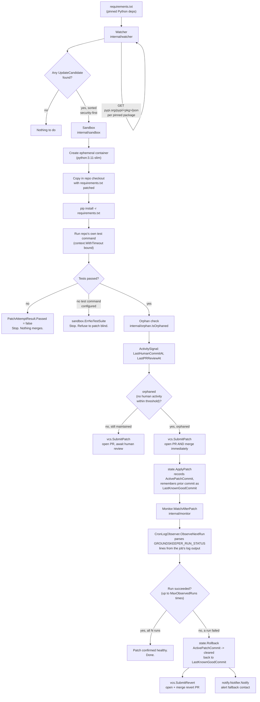

# Architecture

Groundskeeper is a pipeline with a safety net on both ends: nothing lands
without passing tests in a sandbox first, and nothing stays landed if it
breaks production afterward. This document walks the pipeline stage by
stage; see the root `README.md` for the problem statement and a narrative
walkthrough against the demo fixture.

## Flow diagram

## Stage notes

**Watcher (`internal/watcher`).** Parses only exact pins (`pkg==version`);
ranged or unpinned requirements are skipped because Groundskeeper can't
safely reason about which resolved version is actually installed. Every
pinned dependency is checked against both OSV (for known vulnerabilities
affecting the *currently pinned* version) and PyPI (for whether a newer
release exists at all, security-relevant or not). Results are merged into
`UpdateCandidate` values and sorted security-fixes-first so the sandbox
pipeline always processes the highest-priority risk first.

**Sandbox (`internal/sandbox`).** The container is ephemeral and torn down
unconditionally (`defer ContainerRemove(..., Force: true)`) regardless of
outcome. The on-disk checkout of the target repo is never mutated — the
patched `requirements.txt` only exists inside the tar stream copied into the
container. A repo with no configured test command gets a hard
`ErrNoTestSuite`, not a silent skip: Groundskeeper's entire safety case rests
on "tests passed before merge," so there is no code path that proceeds
without that evidence.

**Orphan check (`internal/orphan`).** Deliberately the simplest package in
the codebase: two timestamps in, one boolean out. Its simplicity is the
point — the auto-merge decision downstream should be driven by an easily
auditable, easily tested signal, not a fuzzy heuristic.

**VCS (`internal/vcs`).** The same `SubmitPatch` call handles both outcomes
of the orphan check; only the `orphaned` boolean changes whether the PR it
opens also gets merged immediately. This keeps "open a PR" as the single
source of truth for what the patch looked like, whether or not a human ever
reviews it.

**State (`internal/state`).** The centerpiece. `MaintenanceState` is
deliberately minimal — a last-known-good commit, an active patch commit, and
which candidate produced it — so that `Rollback` is a pure, mechanical
operation with no ambiguity about what "good" means. See
`docs/adr/0002-auto-merge-for-orphaned-repos.md` for why this state machine
is what makes auto-merge acceptable.

**Monitor (`internal/monitor`).** Bridges the gap between "tests passed in a
sandbox" and "actually works in production." `CronLogObserver` expects the
target job to emit an unambiguous status line
(`GROUNDSKEEPER_RUN_STATUS=<exit_code> at=<timestamp>`) rather than trying to
infer success/failure from arbitrary log content, which would be far more
fragile. The first observed failure triggers rollback immediately rather
than waiting out the remaining observation budget.

**Notify (`internal/notify`).** The last link in the chain: once a rollback
happens (automatically, with no human having reviewed anything), a human
absolutely must be told. `SlackNotifier` is the concrete implementation
included in v1; the `Notifier` interface makes adding email/PagerDuty/etc.
straightforward later.
